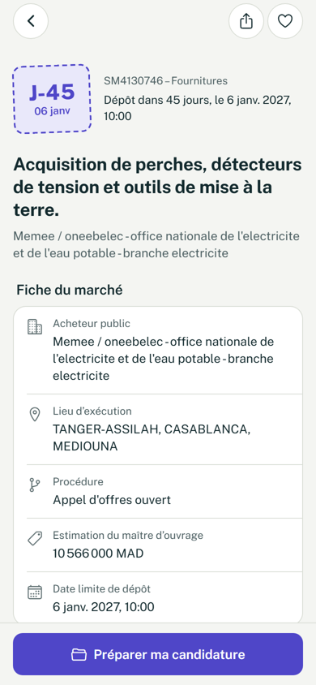
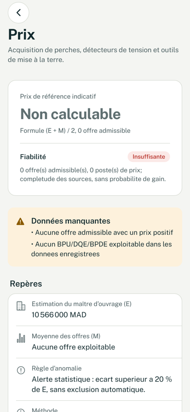
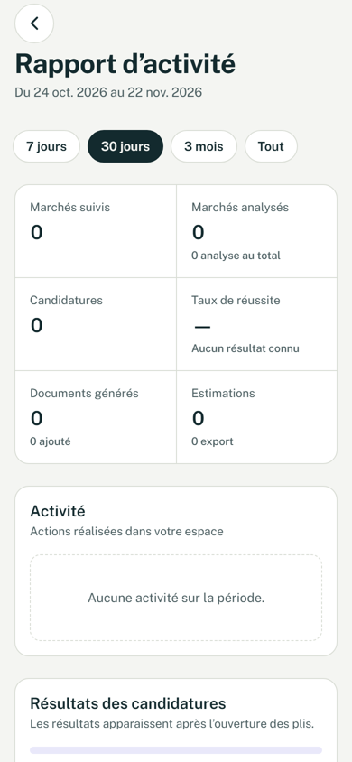
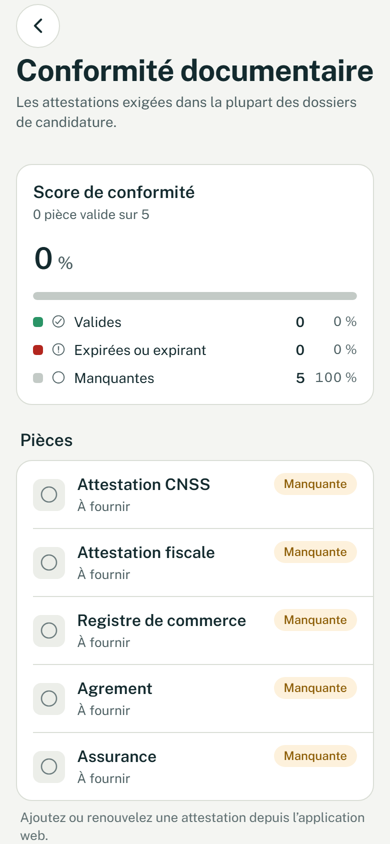

# Marchés publics — application mobile

Application mobile iOS et Android conçue pour accompagner les entreprises marocaines dans leur suivi des marchés publics et la préparation de leurs candidatures. Elle réunit les informations et les actions utiles dans une interface pensée pour un usage quotidien, au bureau comme en déplacement.

## Parcours dans l’application

| Espace | Utilisation |
| --- | --- |
| **Aujourd’hui** | Repérer les prochaines échéances, les dossiers en cours et les actions à traiter. Les repères de date rendent l’urgence visible d’un coup d’œil. |
| **Marchés** | Parcourir et rechercher les consultations, appliquer des filtres, retrouver les favoris et ouvrir la fiche détaillée d’un marché. |
| **Fiche du marché** | Consulter les informations principales, accéder à l’analyse du dossier de consultation et examiner les éléments de prix disponibles. |
| **Analyse assistée par IA** | Explorer les points importants du dossier et poser des questions sur ses documents pour mieux comprendre les exigences de la consultation. |
| **Dossiers de candidature** | Suivre les candidatures, consulter les pièces demandées, ajouter des documents et visualiser l’avancement de la préparation. |
| **Estimation des prix** | Consulter les estimations et les éléments de prix associés pour éclairer la préparation d’une offre. |
| **Statistiques et activité** | Suivre les indicateurs et rapports d’activité, les finances, les quotas de l’abonnement et les informations de conformité. |
| **Compte et préférences** | Retrouver les informations de l’entreprise, les notifications, les options de compte et la gestion de l’abonnement. |

## Aperçu des interfaces

| Aujourd’hui | Marchés | Fiche du marché | Estimation |
|:-:|:-:|:-:|:-:|
|  |  |  |  |

| Analyse d’activité | Abonnement | Conformité | Mode sombre |
|:-:|:-:|:-:|:-:|
|  |  |  |  |

## Interface et expérience mobile

- Thème clair et thème sombre, avec des couleurs et une typographie cohérentes dans l’application.
- Navigation par onglets et écrans adaptés aux formats mobiles iOS et Android.
- Présentation lisible des dates limites, statuts, montants et étapes de candidature.
- États de chargement, listes actualisables et retours visuels pour accompagner les actions.
- Sélection et partage de documents à l’aide des fonctions disponibles sur le téléphone.
- Prise en charge des zones tactiles confortables, des lecteurs d’écran et des préférences de taille du texte.

## Technologies

- React Native et Expo pour les applications iOS et Android.
- TypeScript pour les écrans et composants de l’application.
- Expo Router pour la navigation.
- TanStack Query et Axios pour les données affichées dans l’interface.
- Expo SecureStore pour la session, ainsi que des modules Expo pour les documents, notifications, partage et retour haptique.

## Structure

```text
app/                    Écrans et navigation
  (auth)/               Connexion et inscription
  (tabs)/               Aujourd’hui, marchés, candidatures, prix et compte
  market/[id]/          Détails, analyse et estimation d’un marché
  application/[id].tsx  Préparation d’une candidature
  features/[key].tsx    Espaces et outils complémentaires
src/
  components/           Composants d’interface et graphiques
  screens/              Écrans de statistiques
  theme/                Couleurs, typographie et espacements
  api/                  Accès aux données utilisées par les écrans
  auth/                 Écrans et état de session
  lib/                  Formatage et interactions communes
assets/                 Icônes, polices et éléments visuels
docs/screenshots/       Captures d’écran présentées ci-dessus
```

## Démarrer l’application

Prérequis : Node.js et npm. L’application utilise les données du service auquel elle est connectée ; sans URL de service configurée et accès autorisé, les écrans nécessitant un compte ne peuvent pas afficher les données de l’espace.

```bash
npm ci
```

Configurez l’URL du service dans `EXPO_PUBLIC_API_URL` selon votre environnement, puis lancez Expo :

```bash
npm start
```

Les commandes de développement disponibles sont `npm run typecheck`, `npm run lint` et `npm run web`.
