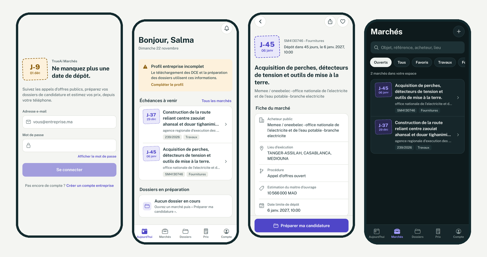
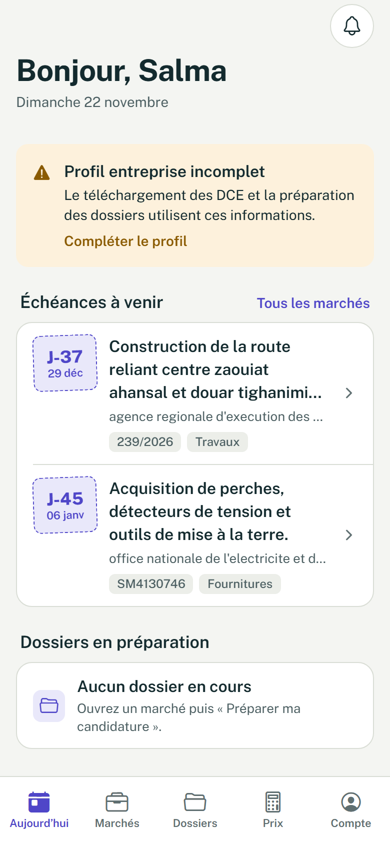
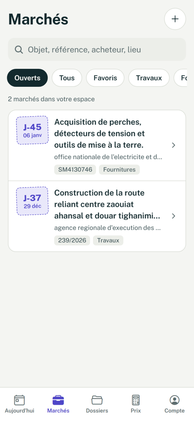
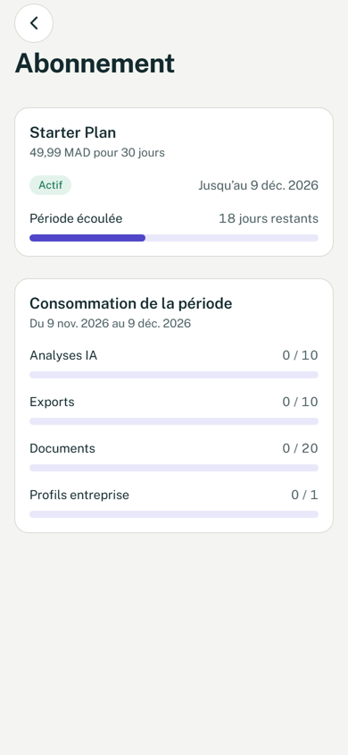
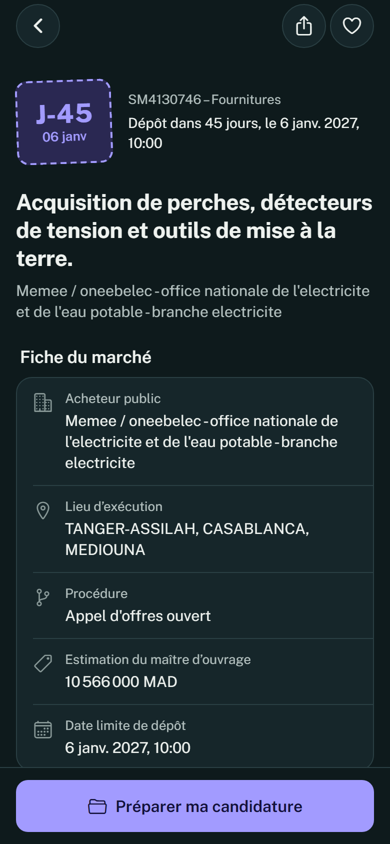

# TrueAi Marchés — application mobile

**L’application mobile qui aide les entreprises marocaines à répondre aux appels d’offres publics : suivre les dates de dépôt, comprendre le dossier de consultation, préparer la candidature et estimer le bon prix.**



> Application iOS et Android réalisée en freelance pour une plateforme SaaS de veille et de réponse aux marchés publics. Ce dépôt présente l’application mobile ; la plateforme serveur et les données du client restent privées.

---

## Le problème

Répondre à un marché public est une course contre la montre. Une PME doit repérer la consultation, télécharger le dossier de consultation (DCE), lire des dizaines de pages pour savoir quelles pièces fournir, rassembler ses attestations à jour, chiffrer son offre… et déposer avant une date limite qui ne pardonne pas.

Ces étapes se font souvent loin du bureau. Le dirigeant ou le chargé d’affaires a besoin de savoir **ce qui arrive à échéance**, **ce qui manque encore** et **à quel prix se positionner**, depuis son téléphone.

## Le concept

L’application mobile est le compagnon de poche de la plateforme web. Elle est construite autour d’une idée simple : **la date de dépôt est l’information la plus importante d’un marché**.

Chaque marché affiche un **tampon d’échéance** — `J-12`, `Auj.`, `Clos` — inspiré des tampons administratifs. Sa couleur indique l’urgence (bientôt, urgent, clos), toujours accompagnée d’un libellé pour rester lisible par tous. C’est l’élément signature de l’interface : on comprend sa journée en un coup d’œil.

## Ce que fait l’application

| Besoin de l’entreprise | Ce que propose l’application |
|---|---|
| **Ne rater aucune échéance** | Écran « Aujourd’hui » avec les prochaines dates de dépôt, compte à rebours sur chaque marché, notifications |
| **Trouver un marché** | Recherche par objet, référence, acheteur ou lieu ; filtres (ouverts, travaux, fournitures, services, favoris) ; ajout d’une consultation depuis le portail officiel par sa référence ou son lien |
| **Comprendre le dossier** | Fiche du marché claire, analyse assistée par IA du dossier de consultation (avec consentement explicite), assistant qui répond aux questions en **citant mot pour mot** les documents |
| **Préparer la candidature** | Liste des pièces exigées avec leur source dans le DCE, ajout de documents depuis le téléphone, suivi de l’avancement, préparation de brouillons à relire |
| **Bien chiffrer** | Prix de référence indicatif, niveau de fiabilité, offres publiées après ouverture des plis, lignes du bordereau des prix |
| **Piloter l’activité** | Indicateurs clés, graphique d’activité, rapport (7 jours à tout l’historique), finances, quotas d’abonnement, score de conformité des attestations, cautions, devis et factures |
| **Gérer son compte** | Profil de l’entreprise (ICE, RC, représentant, RIB), sécurité, **suppression du compte et des données depuis l’application** |

## Captures d’écran

| Aujourd’hui | Marchés | Fiche d’un marché | Prix |
|:-:|:-:|:-:|:-:|
|  |  |  |  |

| Rapport d’activité | Abonnement et quotas | Conformité | Mode sombre |
|:-:|:-:|:-:|:-:|
|  |  |  |  |

## Design

- **Système de design maison** : couleurs, typographie et espacements définis une fois et utilisés partout, en mode clair et en mode sombre (pas une simple inversion : chaque couleur sombre est choisie et vérifiée).
- **Typographie Public Sans**, conçue pour les services publics, avec des chiffres alignés pour les montants et les comptes à rebours.
- **Conventions iOS et Android** : grands titres, listes groupées, tirer pour actualiser, chargements progressifs, action principale fixée en bas d’écran, retour haptique.
- **Graphiques sans bibliothèque externe** : indicateurs, histogrammes interactifs (toucher une barre pour lire sa valeur, vue tableau disponible), barres classées, jauges. Les couleurs sont validées pour rester distinguables par les personnes daltoniennes.
- **Accessibilité** : zones tactiles d’au moins 44 points, libellés pour les lecteurs d’écran, l’information n’est jamais portée par la couleur seule, respect du réglage « réduire les animations », texte qui s’adapte à la taille choisie par l’utilisateur.
- **Textes pensés pour l’utilisateur** : messages d’erreur qui disent quoi faire, écrans vides qui proposent l’étape suivante, aucun jargon technique.

## Comment l’application communique avec la plateforme

L’application est un client natif : elle ne contient aucune logique métier sensible et n’embarque aucune donnée du client. Elle dialogue avec la plateforme au travers d’une **API REST privée** :

- **JSON sur HTTPS**, authentification par **jeton**, stocké dans le trousseau sécurisé du téléphone (Keychain / Keystore) ;
- **listes paginées** chargées au fil du défilement ;
- **traitements longs asynchrones** (analyse de documents, estimations) suivis par interrogation régulière de leur état, avec barre de progression ;
- **envoi de fichiers** (PDF, Word, Excel) depuis le sélecteur de documents du téléphone, et **téléchargement sécurisé** des pièces privées, ensuite partageables ;
- **session expirée** détectée automatiquement, avec retour à l’écran de connexion ;
- les données privées (coûts, marges, documents) ne sont pas conservées sur le téléphone au-delà de la session.

Les traitements IA ne sont jamais déclenchés sans l’accord explicite de l’utilisateur, et leurs résultats sont présentés comme une aide à vérifier, jamais comme une vérité.

## Technologies

| | |
|---|---|
| Framework | **React Native** avec **Expo** (SDK 58), une seule base de code pour iOS et Android |
| Langage | **TypeScript** en mode strict |
| Navigation | **Expo Router** (navigation par fichiers, onglets, liens profonds) |
| Données | **TanStack Query** (cache, rafraîchissement, pagination infinie), **Axios** |
| Sécurité | **Expo SecureStore** pour le jeton de session |
| Fonctions natives | Sélection et partage de fichiers, navigateur intégré, retour haptique, partage natif |
| Qualité | ESLint, vérification de types, `expo-doctor` (20/20) |
| Distribution | **EAS Build / Submit** : profils développement, test interne et production |

## Organisation du code

```
app/                    Écrans (une route = un fichier)
  (auth)/               Connexion, inscription
  (tabs)/               Aujourd’hui, Marchés, Dossiers, Prix, Compte
  market/[id]/          Fiche, analyse et prix d’un marché
  application/[id].tsx  Dossier de candidature
  features/[key].tsx    Fonctions secondaires (documents, calendrier, équipe…)
src/
  theme/                Système de design (couleurs clair/sombre, typographie, espacements)
  components/           Composants d’interface, tampon d’échéance, graphiques
  screens/              Écrans de statistiques
  api/                  Client HTTP, hooks de données, téléchargements
  auth/                 Session et authentification
  lib/                  Formatage (dates, montants, statuts), confirmations
assets/                 Icône, écran de démarrage
docs/screenshots/       Captures de ce document
```

## Prête pour les stores

- Identifiants iOS / Android, icônes adaptatives et écran de démarrage clair et sombre
- Manifeste de confidentialité iOS et permissions Android réduites au strict nécessaire
- Suppression du compte depuis l’application (exigée par l’App Store et Google Play)
- Profils de build et de publication EAS

## Lancer le projet

L’application a besoin d’un accès à l’API de la plateforme, qui est privée. Sans cet accès, l’écran de connexion s’affiche mais aucune donnée ne peut être chargée.

```bash
npm ci
cp .env.example .env        # renseigner EXPO_PUBLIC_API_URL
npx expo start              # puis scanner le QR code avec Expo Go
```

Vérifications :

```bash
npm run typecheck
npm run lint
npx expo-doctor
```

---

Projet réalisé en freelance. Pour un projet similaire — application mobile, refonte d’interface ou produit SaaS —, contactez-moi via mon profil GitHub.
